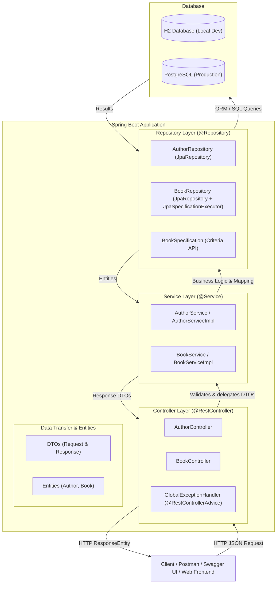

# 📚 RESTful Bookstore API

[](https://www.oracle.com/java/technologies/javase/jdk21-archive-downloads.html)
[](https://spring.io/projects/spring-boot)
[](https://maven.apache.org/)
[](https://opensource.org/licenses/MIT)
[]()
[]()

A production-ready, industry-standard **RESTful Bookstore API** built with **Java 21** and **Spring Boot 3**. This enterprise-grade backend application provides full CRUD operations for managing authors and books, complex filtering, pagination, multi-field sorting, rigorous Jakarta Bean Validation, centralized error handling, automated unit and integration tests, and interactive Swagger/OpenAPI documentation.

---

## 🏛️ System Architecture

The application is structured following a strict **Layered (N-Tier) Architecture** to ensure separation of concerns, high testability, and maintainability.



---

## 🗄️ Database Design (Entity-Relationship)

The system models a classic **One-to-Many (`1:N`)** relationship between **Author** and **Book**:

```mermaid
erDiagram
    AUTHORS ||--o{ BOOKS : "writes (1:N)"
    
    AUTHORS {
        bigint id PK "Auto-generated identity"
        varchar(100) name "Mandatory"
        varchar(150) email "Mandatory, Unique"
        text biography "Author biography"
    }
    
    BOOKS {
        bigint id PK "Auto-generated identity"
        varchar(200) title "Mandatory"
        varchar(20) isbn "Mandatory, Unique (10 or 13 digits)"
        text description "Book synopsis"
        numeric(10,2) price "Mandatory, Greater than 0"
        date published_date "Past or present date"
        varchar(50) genre "Book genre / category"
        integer stock_quantity "Mandatory, Min 0"
        bigint author_id FK "Mandatory foreign key referencing AUTHORS(id)"
    }
```

### Key Relational Mapping Highlights
* **Author (Parent / Non-Owning Side)**: Annotated with `@OneToMany(mappedBy = "author", cascade = CascadeType.ALL, orphanRemoval = true)`. Deleting an author cascades to remove their books.
* **Book (Owning Side)**: Annotated with `@ManyToOne(fetch = FetchType.LAZY) @JoinColumn(name = "author_id", nullable = false)`. Contains the foreign key `author_id`.
* **Decoupled DTOs**: DTOs prevent infinite Jackson JSON serialization recursion when traversing bidirectional relationships.

---

## 🚀 Key Features

* **Complete CRUD Operations**: Create, Read, Update, and Delete for Authors and Books.
* **Dynamic Search & Filtering**: Filter books by `title` (substring, case-insensitive), `genre`, `authorId`, `minPrice`, and `maxPrice` powered by **Spring Data JPA Criteria API (`Specification`)**.
* **Pagination & Multi-Field Sorting**: Configurable `page`, `size`, `sortBy`, and `direction` with sort-field whitelisting to safeguard against SQL injection.
* **Centralized Exception Handling**: Custom exceptions (`ResourceNotFoundException`, `DuplicateResourceException`, `InvalidRequestException`) mapped into consistent, human-readable error JSON via `@RestControllerAdvice`.
* **Jakarta Bean Validation**: Comprehensive validation rules (`@NotBlank`, `@Email`, `@Positive`, `@Min`, `@PastOrPresent`, `@Pattern` for ISBN-10/13).
* **Multi-Environment Profiles**:
  * `dev`: Fast In-Memory H2 database with Web Console (`/h2-console`) and formatted SQL logs.
  * `prod`: High-performance PostgreSQL with HikariCP connection pooling and externalized environment variables.
* **Interactive Documentation**: OpenAPI 3 / Swagger UI embedded at `/swagger-ui/index.html`.
* **Automated Test Suite**: 28 automated tests across Unit (Mockito) and Integration (MockMvc) layers.

---

## 🛠️ Technology Stack

| Component | Technology | Version |
| :--- | :--- | :--- |
| **Language** | Java (JDK) | 21 LTS |
| **Framework** | Spring Boot | 3.4.3 |
| **Build Tool** | Apache Maven | 3.9+ |
| **Web Engine** | Spring MVC & Embedded Tomcat | 3.4.3 |
| **ORM / Persistence** | Spring Data JPA / Hibernate | 6.6.8 |
| **Development Database** | H2 Database (In-Memory) | 2.3.232 |
| **Production Database** | PostgreSQL Driver | 42.7.5 |
| **API Documentation** | Springdoc OpenAPI UI | 2.8.5 |
| **Validation** | Jakarta Bean Validation (Hibernate Validator) | 8.0.2 |
| **Unit & Mock Testing** | JUnit 5 & Mockito | Latest |
| **Integration Testing** | Spring Boot Test & MockMvc | Latest |

---

## 📋 API Endpoints Reference

### 👤 Author Endpoints

| Method | Endpoint | Description | Status Code |
| :--- | :--- | :--- | :--- |
| `POST` | `/api/authors` | Register a new author | `201 Created` |
| `GET` | `/api/authors` | Retrieve paginated authors (`?page=0&size=10&sortBy=id&direction=asc`) | `200 OK` |
| `GET` | `/api/authors/{id}` | Retrieve author by ID | `200 OK` / `404` |
| `PUT` | `/api/authors/{id}` | Update author details by ID | `200 OK` / `404` / `409` |
| `DELETE` | `/api/authors/{id}` | Delete author and cascade delete books | `204 No Content` / `404` |

### 📖 Book Endpoints

| Method | Endpoint | Description | Status Code |
| :--- | :--- | :--- | :--- |
| `POST` | `/api/books` | Create a new book linked to an author | `201 Created` |
| `GET` | `/api/books` | Search/filter books with pagination and sorting | `200 OK` |
| `GET` | `/api/books/{id}` | Retrieve book by ID | `200 OK` / `404` |
| `PUT` | `/api/books/{id}` | Update book details by ID | `200 OK` / `404` / `409` |
| `DELETE` | `/api/books/{id}` | Delete book by ID | `204 No Content` / `404` |
| `GET` | `/api/books/author/{authorId}` | Retrieve all books by an author | `200 OK` / `404` |

---

## 🧪 Sample Payloads

### 1. Create Author (`POST /api/authors`)
```json
{
  "name": "Robert C. Martin",
  "email": "unclebob@cleancode.com",
  "biography": "Co-author of Agile Manifesto and author of Clean Code."
}
```
**Response (`201 Created`)**:
```json
{
  "id": 1,
  "name": "Robert C. Martin",
  "email": "unclebob@cleancode.com",
  "biography": "Co-author of Agile Manifesto and author of Clean Code.",
  "bookCount": 0
}
```

---

### 2. Create Book (`POST /api/books`)
```json
{
  "title": "Clean Code",
  "isbn": "9780132350884",
  "description": "A handbook of agile software craftsmanship.",
  "price": 39.99,
  "publishedDate": "2008-08-01",
  "genre": "Software Engineering",
  "stockQuantity": 50,
  "authorId": 1
}
```
**Response (`201 Created`)**:
```json
{
  "id": 1,
  "title": "Clean Code",
  "isbn": "9780132350884",
  "description": "A handbook of agile software craftsmanship.",
  "price": 39.99,
  "publishedDate": "2008-08-01",
  "genre": "Software Engineering",
  "stockQuantity": 50,
  "authorId": 1,
  "authorName": "Robert C. Martin"
}
```

---

### 3. Error Response Sample (`400 Bad Request`)
```json
{
  "timestamp": "2026-11-09T13:39:14",
  "status": 400,
  "error": "Bad Request",
  "message": "Validation failed for one or more fields",
  "path": "/api/books",
  "validationErrors": {
    "title": "Title must be between 1 and 200 characters",
    "price": "Price must be greater than zero",
    "isbn": "ISBN must be a valid 10 or 13-digit format (digits and optional trailing X)",
    "stockQuantity": "Stock quantity cannot be negative"
  }
}
```

---

## 💻 Local Setup & Running

### Prerequisites
* **Java 21 LTS** installed (`java -version`)
* **Maven 3.9+** installed (`mvn -version`)
* **Git** installed

### Steps
1. Clone the repository:
   ```bash
   git clone https://github.com/UmaMaheshwari7474/bookstore-api.git
   cd bookstore-api
   ```
2. Build and run tests:
   ```bash
   mvn clean test
   ```
3. Run the application locally:
   ```bash
   mvn spring-boot:run
   ```
4. Access:
   * **Base API**: `http://localhost:8080/api/books`
   * **Swagger UI Documentation**: [http://localhost:8080/swagger-ui/index.html](http://localhost:8080/swagger-ui/index.html)
   * **OpenAPI JSON**: [http://localhost:8080/api-docs](http://localhost:8080/api-docs)
   * **H2 Database Console**: [http://localhost:8080/h2-console](http://localhost:8080/h2-console)
     * JDBC URL: `jdbc:h2:mem:bookstoredb`
     * Username: `sa`
     * Password: *(leave blank)*

---

## 📮 Postman Collection

The repository includes pre-configured collection and environment files in the `postman/` folder:

* [`postman/Bookstore_API_Collection.postman_collection.json`](postman/Bookstore_API_Collection.postman_collection.json)
* [`postman/Bookstore_API_Environment.postman_environment.json`](postman/Bookstore_API_Environment.postman_environment.json)

### How to Import:
1. Open **Postman Desktop**.
2. Click **Import** (top left).
3. Select both JSON files from the `postman/` folder.
4. Select the **Bookstore API Local Environment** active environment in the top right dropdown.
5. Execute requests sequentially!

---

## ☁️ Production Deployment Guide (Render / PostgreSQL)

### 1. Create PostgreSQL Database on Render
1. Log in to [Render](https://render.com).
2. Click **New +** -> **PostgreSQL**.
3. Name: `bookstore-postgres`, Database: `bookstoredb`, User: `bookstore_user`.
4. Copy the **Internal Database URL** or connection credentials (`DATABASE_URL`, `DB_USERNAME`, `DB_PASSWORD`).

### 2. Deploy Web Service on Render
1. Click **New +** -> **Web Service**.
2. Connect your GitHub repository: `https://github.com/UmaMaheshwari7474/bookstore-api`.
3. Configure:
   * **Runtime**: Java
   * **Build Command**: `mvn clean package -DskipTests`
   * **Start Command**: `java -Dspring.profiles.active=prod -jar target/bookstore-api-0.0.1-SNAPSHOT.jar`
4. In **Environment Variables**, add:
   * `SPRING_PROFILES_ACTIVE`: `prod`
   * `DATABASE_URL`: `jdbc:postgresql://<render-db-host>:5432/bookstoredb`
   * `DB_USERNAME`: `<your-db-user>`
   * `DB_PASSWORD`: `<your-db-password>`
5. Click **Create Web Service**.

---

## 📄 License
This project is licensed under the [MIT License](LICENSE).
